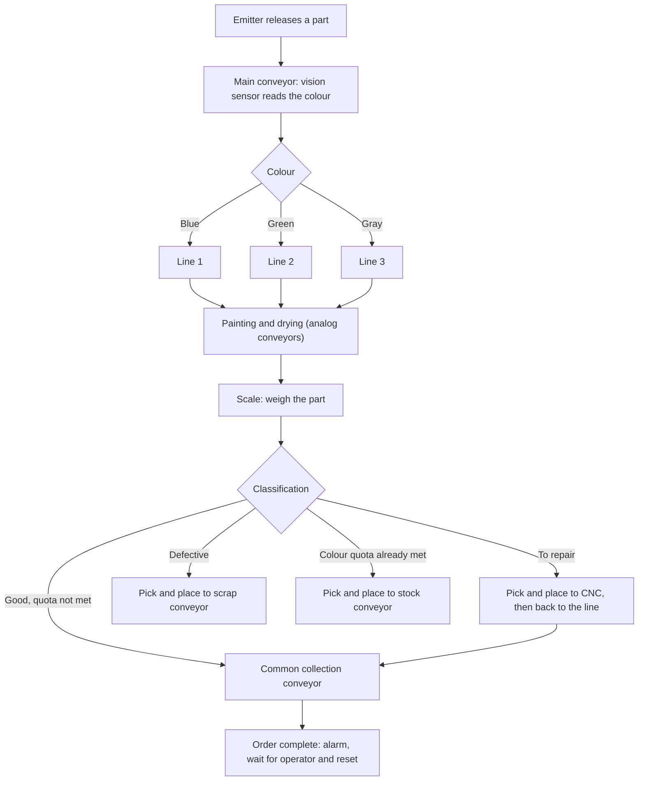

# Automated Production Line: PLC + HMI + Factory IO

A simulated industrial production line controlled by an **Omron PLC** and an **HMI**, both programmed in **Sysmac Studio**, with the plant simulated in **Factory IO**. The control logic is organized as modular **GRAFCETs** (sequential function charts) that hand over to each other through flags.

Three parallel lines process parts of different colours. Each line paints and dries the part, weighs it to judge quality, and then sends it to the right destination: the finished order, a CNC machine for repair, the scrap bin or the stock area. An operator defines each order from the HMI, follows production in real time, and can switch between production and maintenance modes.

> Project developed for the course **Automation**, BSc in **Electrical and Computer Engineering**, **Instituto Politécnico do Cávado e Ave (IPCA)**, **2st year**.

---

## How it works



Each colour line (steps *Painting and drying* to *Classification*) is a separate set of conveyors, sensors and a pick and place, running independently of the others.

### Part classification

During a preliminary study, the scale readings below were measured for each part state, and are used to classify the parts:

| Scale reading | Blue | Green | Gray |
|---|---|---|---|
| Good part | 350 | 350 | 450 |
| Part to repair | 400 | 400 | 500 |
| Defective part | 250 | 250 | 350 |

| Result | Destination |
|---|---|
| Good part, colour quota not yet met | The blade lowers and conveyors carry it to the common collection |
| Part to repair | The pick and place diverts it to the CNC conveyors. After repair it rejoins the good parts on the way to the common collection |
| Defective part | The pick and place rotates 90° and drops it on the scrap conveyor |
| Colour quota already met | The pick and place rotates 180° and sends it to the stock conveyor, to be kept for future orders |

---

## Repository structure

```
.
├── Communication library     # PLC <-> Factory IO data exchange
├── Sysmac Studio project     # PLC program and HMI
├── Factory IO scene]          # plant simulation
└── README.md
```

---

## Operating modes

The mode is chosen with a two-position selector on the control panel.

| Mode | Selector | Behaviour |
|---|---|---|
| **Production** | 0 | Fully automatic. Traffic lights stay red until the **Start** button is pressed, then turn green. Orders are placed from the HMI by users with a high enough access level |
| **Maintenance** | 1 | Automatic logic is disabled and new orders are blocked. Components of each section (main line, the three colour lines, collection) can be controlled individually from the HMI, with yellow flashing LEDs on the selected section. Access requires an authorized user |

### Safety and stop behaviour

- **Emergency stop:** every device is stopped immediately, the traffic lights turn red, an alarm is shown on the HMI, and **all grafcets are forced back to step 0**. The system stays inactive until the emergency button is released, so operations restart in a controlled way.
- **Controlled stop (STOP):** each stage finishes its current operation and stops at a predefined safe point (for example, in front of the sensor before the painting zone). Parts being collected finish their path to the end. A flag set by the stop button conditions the transitions of those stages, and the line resumes after a system rearm.
- **Order complete:** when the quantities of all three colours are reached, an alarm sounds, the order LED turns green, the line LEDs turn yellow and the system stops. When the operator removes the order and presses **Reset**, the counters are cleared and the line is ready for a new order.

---

## Control architecture: GRAFCET

Each process stage is a small, autonomous grafcet. Stages do not call each other directly. At the end of a sequence a stage raises a **flag**, and the next stage starts when it sees that flag. This keeps stages independent, so one can be modified without affecting the others, and each flag can be monitored on its own while debugging.

A `PPBusy` flag arbitrates the use of each pick and place, and a counter-based condition (good parts compared with total minus repaired parts) controls when conveyors may stop.

The modules are summarized below.

| # | Grafcet | Role |
|---|---|---|
| 1 | Startup | Reads the selector, sets the lights, and starts the line after the Start button and a timer. Returns to step 0 on emergency or stop |
| 2 | Main conveyor | Turns on the green lights, removers, emitters and CNCs. The vision sensor identifies the colour and the diverting arm sends the part to its line |
| 3 | Line start (per colour) | Runs the first conveyor of the line until the part reaches the sensor at its end |
| 4 | Painting and drying | Runs the analog conveyors, which simulate painting and drying, until the part reaches the sensor before the scale |
| 5 | Scale conveyor | Moves the part onto the scale and stops it for weighing |
| 6 | Weight analysis | Waits for the pick and place to be free (or for a good part that does not need it), reads the weight and sets the flag for the destination |
| 7 | Good part | Lowers the blade, runs the conveyors and counts a good part |
| 8 | Collect good part | Carries the part to the common collection and counts the total |
| 9 | Defective part | Pick and place grabs the part, rotates 90°, drops it on the scrap conveyor and counts the scrap |
| 10 | Collect scrap | Runs the conveyors to the remover |
| 11 | Repair part | Pick and place diverts the part towards the CNC conveyors and counts the repair |
| 12 | Transport to CNC | Runs the conveyors up to the CNC entrance |
| 13 | CNC exit | Carries the repaired part from the CNC to the common collection |
| 14 | Collect stock | Runs the stock conveyors to the remover |
| 15 | To stock | Pick and place rotates 180° to the stock line and counts the stock |
| 16 | Common collection | Counts the parts entering and leaving the final conveyor. When all quotas are met it stops the system, sounds the alarm and waits for the reset |
| 17 | Maintenance mode | Manual control of each section, with LED signalling per section |

---

## HMI

The whole interface was built in Sysmac Studio.

- **New order page:** the operator enters the quantity of blue, green and gray parts and presses *Nova Encomenda*. The values are sent to the PLC and also stored in a history. Three `single[10]` arrays keep the last 10 orders, using a shift mechanism so the most recent order is always first, and the five most recent are shown on screen.
- **Production page:** live counts per colour of defective parts, good parts ready for packing and parts in stock, plus the current order.
- **Maintenance page:** manual control of each section, with directional controls for the pick and places.
- **Alarms:** *order ready* (needs acknowledgement), *stop* and *emergency*, shown as pop-ups. Messages are available in several languages.
- **Language selection:** Portuguese, English, German and Spanish.
- **Access control:** the *new order* page is blocked while the selector is in maintenance, and the maintenance page is restricted while it is in production. Placing orders and entering maintenance also require a user with sufficient access level.

---

## PLC program

### I/O variable library

Inside the Sysmac Studio project, all physical and virtual inputs and outputs are mapped once, in a library of named variables organized by category (conveyors, analog conveyors, curved conveyors, opto switches, buttons, pick and places, scales, stop blades, pivot arms, emitters and removers, CNC machines, traffic lights and alarm). The program only uses these names, so changing a sensor's address means editing the library alone, with no change to the logic.

### Communication with Factory IO

The data exchange between the PLC and Factory IO is handled by the **communication library** included in this repository. It works over Modbus and is configured with four frames (node address 1):

| Frame | Function | Direction | Size |
|---|---|---|---|
| `[0]` | 02, Read Discrete Inputs | Factory IO → PLC | 49 digital inputs |
| `[1]` | 15, Write Multiple Coils | PLC → Factory IO | 129 digital outputs |
| `[2]` | 04, Read Input Registers | Factory IO → PLC | 10 analog inputs |
| `[3]` | 16, Write Multiple Registers | PLC → Factory IO | 10 analog outputs |

### Analog signals

The painting and drying conveyors have adjustable speed. A potentiometer value is read as a `WORD`, converted to `REAL` for processing, scaled, converted to `INT` and written to the analog output. Adjusting the speed changes how long a part spends in painting and drying.

### Emergency logic

The emergency button forces the step variable of every grafcet back to 0 with a ladder `MOVE` instruction, which makes the stop immediate and returns the whole line to its initial state. The same signal drives the HMI emergency alarm.

---

## Simulated plant

**Actuators:** digital, analog and curved conveyors, pivot arms (diverters), traffic lights, alarm, two-axis pick and places, stop blades, emitter, removers and CNC machines.

**Sensors and inputs:** diffuse (direct reflection) photoelectric sensors (opto switches), vision sensor, potentiometers, scales, and the Start, Stop, Emergency and mode-selector buttons.

---

## Running the project

Requires **Factory IO** and **Sysmac Studio**.

1. Open the Factory IO scene.
2. Open the Sysmac Studio project (PLC program and HMI) and make sure the communication library from this repository is added to it.
3. Check that the Modbus communication between the PLC and Factory IO matches the frame layout above.
4. Set the selector to **0** (production), enter the order quantities on the HMI with an authorized user, and press **Start**.

---

## Known issues

- **Partial reactivation after Stop:** after pressing Stop and then Start, the green LEDs only light up when the main conveyor grafcet returns to step 1.
- **Consecutive parts on the scale:** if two parts are on the scale conveyor at the same time, only the first is processed by the pick and place.
- **Common collection counting:** the counter handles only one part at a time, which affects the synchronization with the exit counter. One counter per line, summed for the comparison, would fix this.
- **Maintenance direction arrows:** the directional controls for the pick and places sometimes move incorrectly, probably because of the association between HMI variables and the real signals. Replacing them with simple buttons, like those used for the conveyors, is suggested.
- **Larger orders:** small orders (2 parts) behave correctly, but with larger ones (5 parts) conflicts appear in the common collection, mainly when CNC-repaired parts merge with good parts coming straight from the line.

## Future improvements

- Fix the issues above before adding new features.
- An **automatic stock warehouse** that reuses surplus parts when a new order of the same colour starts, with new HMI views: stock by colour in a matrix layout, reuse history and automatic reintegration of parts into the line.
- An automatic packaging stage.

---

## Notes

- The comments, HMI texts and variable names are mainly in Portuguese.

## Author

**Ivo Azevedo**
